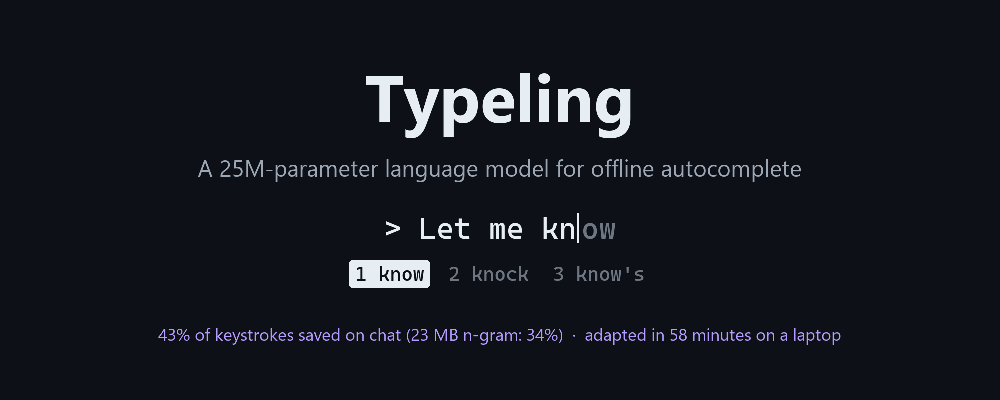
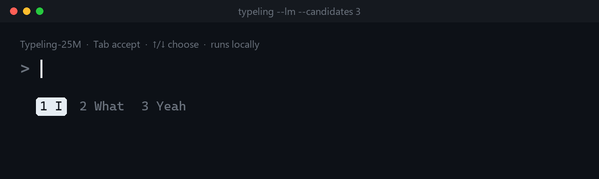
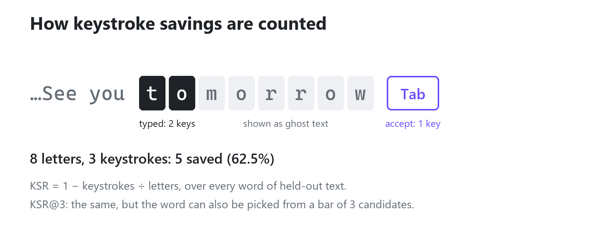
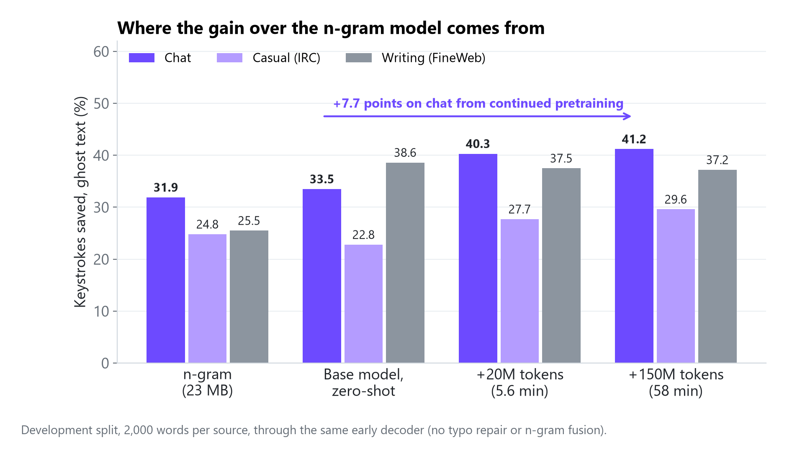
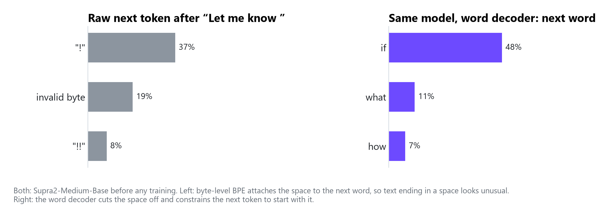
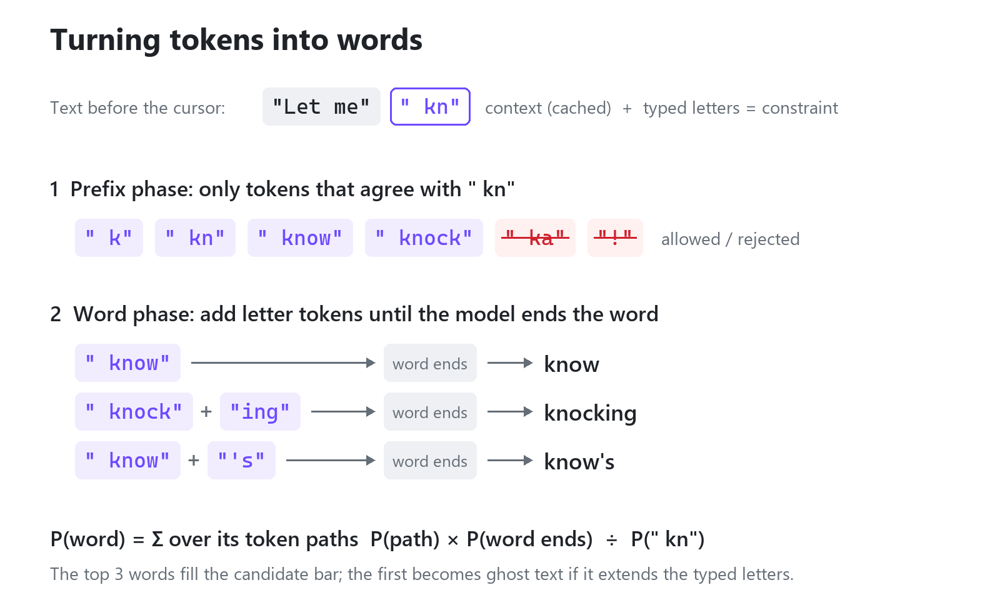
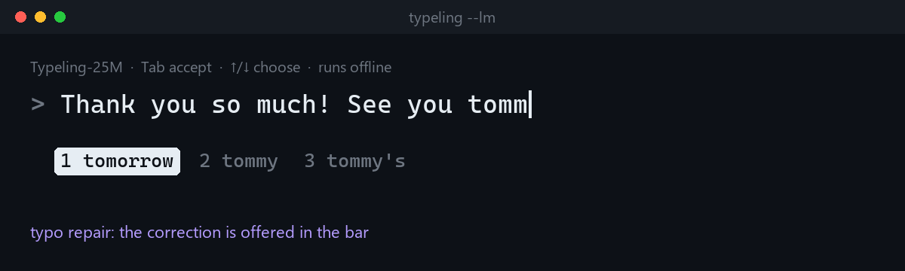
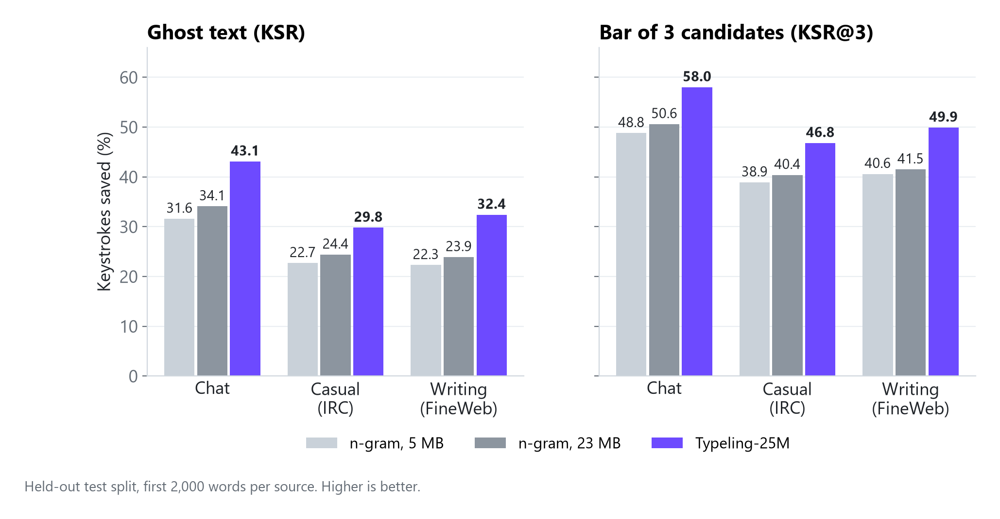

# I Adapted a 25M-Parameter Language Model to Typing in an Hour on a Laptop



Phone keyboards are good at finishing your words and guessing the next one. If you want the same thing offline on a desktop or inside your own tool, there is not much to grab. The models inside Gboard or SwiftKey are closed. Open language models are a poor fit out of the box: most are hundreds of millions of parameters or more and trained for chat and benchmarks, the small ones are pretrained on web text rather than on how people type, and they predict subword tokens instead of words.

So I built Typeling: an open, offline English typing predictor. It has two parts under the same Python API:

- A pure-Python n-gram kernel with a bundled 5 MB model and zero dependencies.
- Typeling-25M, a 25.4M-parameter causal language model, plus a word-level decoder that turns its token predictions into completions, next-word predictions and typo fixes. The model starts from SupraLabs' Supra2-Medium-Base (https://huggingface.co/SupraLabs/Supra2-Medium-Base), pretrained on 20B tokens of educational web text, which I adapted to typing with 58 minutes of continued pretraining on one laptop GPU.



On held-out chat text, Typeling-25M saves 43.1% of keystrokes with inline ghost text, and 58.0% with a three-candidate bar, against 34.1% and 50.6% for an unpruned 23 MB trigram model built from the same 47M-word corpus (the language model also has the base model's 20B tokens behind it). Those numbers are for the 16-bit weights through the PyTorch decoder, which needs about 549 MB of memory. There is also a 27.6 MB 8-bit GGUF file for llama.cpp, but the word-level decoder does not run on it yet. The code and Typeling-25M are under the Apache 2.0 license, and the bundled 5 MB n-gram model is under ODC-By 1.0:

- GitHub: https://github.com/scarletkc/typeling
- Model (16-bit safetensors): https://huggingface.co/ScarletKc/Typeling-25M
- GGUF (Q8_0): https://huggingface.co/ScarletKc/Typeling-25M-GGUF
- PyPI: https://pypi.org/project/typeling/
- Technical report (PDF): https://github.com/scarletkc/typeling/releases/latest/download/typeling-technical-report.pdf

---

## How do you measure autocomplete?

An autocomplete system has two common interfaces. Ghost text shows the single best completion inline in grey, and you press Tab to accept it. A candidate bar sits below the line and always shows the top three words, and you pick one with a key.

To compare models without a user study, the benchmark simulates typing held-out text one letter at a time. For every word, the simulated typist types 0, 1, 2, ... letters and checks the suggestions after each key. With ghost text, the top suggestion is shown when its probability is at least 0.3 and it extends the letters already typed; as soon as it matches the intended word, the typist accepts it with one keystroke. With the candidate bar, the typist picks the intended word with one keystroke as soon as it appears among the top three. That fits a tap or a number key; in the terminal demo, the second and third candidates currently take an arrow key plus Tab, so there the bar saves somewhat less than the benchmark says.



If an 8-letter word is accepted after 2 letters, it costs 3 keystrokes instead of 8 and saves 5. Across a set of texts, the keystroke savings rate is:

$$\mathrm{KSR} = 1 - \frac{\text{keystrokes used}}{\text{letters in the target words}}$$

KSR@3 is the same calculation for the three-candidate bar. I also track the precision of ghost text (how often a shown suggestion is actually accepted, because wrong grey text is distracting) and acc@0, which is next-word accuracy before any letter of the word is typed.

The benchmark covers five corpora, grouped into three domains: chat (SODA, WildChat user turns, OpenAssistant oasst2 user turns), casual internet chat (Ubuntu IRC logs) and general writing (FineWeb). Every design choice was made on the development splits; the test splits were run once at the end.

---

## How far a bigger n-gram model gets

Typeling started as a pure-Python trigram model: interpolated modified Kneser-Ney smoothing over a 60,000-word vocabulary, pruned to a 5 MB binary file with one-byte quantized probabilities, plus a recency cache of recent words in the document and a local user model. It loads in about 30 ms and answers a keystroke in 41 to 115 microseconds.

The problem is that a trigram only ever sees the previous two words. To check how much the 5 MB file was holding it back, I built an unpruned model on the same 47M-word corpus. The file grew from 5 MB to 23.4 MB (1.66M bigrams, 3.41M trigrams), and keystroke savings on the development split (20,000 words per source) went up by about two points: 32.1% to 34.3% on chat, 22.8% to 24.6% on IRC, 23.1% to 25.0% on FineWeb. Next-word accuracy barely moved (28.6% to 29.2% on SODA, 21.3% to 22.6% on WildChat).

More n-gram size mostly stores rarer word triples. It does not teach the model what the sentence is about five words back. I did not try higher orders, a larger vocabulary or lower count cutoffs, so this is the limit of this trigram model, not of n-grams in general.

---

## Picking a tiny base model

I wanted a recent causal language model under about 50M parameters, under the Apache License, in an architecture that llama.cpp already runs. Before training anything, I ran the candidates zero-shot through an early version of the word decoder on the development split (ghost-text KSR %, 2,000 words per source, a smaller sample than above, which is why the n-gram numbers differ):

| Model | Params | Chat | Casual (IRC) | Writing (FineWeb) |
|---|---|---|---|---|
| n-gram | 5 MB | 29.7 | 22.8 | 23.5 |
| n-gram, unpruned | 23 MB | 31.9 | 24.8 | 25.5 |
| Pythia-14M | 14.1M | 28.5 | 21.8 | 33.6 |
| Pythia-31M | 30.5M | 31.2 | 22.9 | 36.6 |
| Supra2-Medium-Base | 25.4M | 33.5 | 22.8 | 38.6 |
| Supra-50M-Base, simulated 4-bit | 51.8M | 35.0 | 23.4 | 41.0 |
| Supra-50M-Base | 51.8M | 35.6 | 24.1 | 42.1 |

Two things stood out in this table.

First, on web writing (FineWeb), even the 14M Pythia model beats the 23 MB n-gram by 8 points. Long-range context matters in articles. On IRC, though, neither Supra base model beats the unpruned n-gram zero-shot. Both were trained on 20B tokens of FineWeb-Edu, which is educational web text; they had never seen chat logs.

Second, Supra-50M-Base (Llama architecture, 51.8M parameters) is 1.3 to 3.5 KSR points ahead of Supra2-Medium-Base (Qwen3 architecture, 25.4M parameters: 7 layers, hidden size 512, 8 heads, a 16,384-token byte-level BPE vocabulary with tied embeddings), and it keeps most of that lead under simulated 4-bit quantization.

I picked the smaller Supra2-Medium-Base anyway, for half the parameters and half the file and memory at equal precision. In hindsight, that size argument is weaker than it looked: a 4-bit GGUF of the 50M model would be around 30 MB (estimated from the parameter count), almost the same size as the 27.6 MB 8-bit GGUF I shipped for the 25M model, and standard scaling results favor more parameters at 4 bits over fewer at 8 bits. I only compared the two models zero-shot, so whether 50M at 4 bits beats 25M at 8 bits after training is still an open question.

---

## One hour of continued pretraining

To move Supra2-Medium-Base from educational web text to everyday typing, I ran full-parameter continued pretraining on 150M tokens (about 2.2 epochs of the 67M-token corpus) in bf16 with AdamW, packed 512-token sequences, and a peak learning rate of 6e-4. On one laptop RTX 5070 Ti GPU, the whole run took 58 minutes.

The training mix weights chat heavily while keeping FineWeb so general writing does not degrade:

| Corpus | License | Words | Share of mix |
|---|---|---|---|
| FineWeb | ODC-By 1.0 | 18.5M | 30% |
| SODA | CC BY 4.0 | 16.3M | 25% |
| WildChat-1M (user turns) | ODC-By 1.0 | 7.5M | 27% |
| Ubuntu IRC | Public domain | 4.4M | 17% |
| OpenAssistant oasst2 (user turns) | Apache-2.0 | 0.4M | 1% |

Emails, URLs and phone numbers are stripped from FineWeb; WildChat, oasst2 and IRC keep only short turns that look typed by a person and contain none of those, and WildChat also drops turns flagged as toxic or redacted. oasst2 is held at 1% of the mix because it only has about 0.5M tokens; at 5% it would be repeated 15 times.

Two small changes during training were specific to typing:

### 1. Initializing the text separator

Supra2-Medium-Base was pretrained on documents concatenated without separators. Its `<s>` and `</s>` token embeddings were completely untrained: placing `<s>` at the start of a text gave per-word perplexities 3% to 30% higher than starting with a newline. Before training, I copied the newline token's embedding row into `</s>` and used `</s>` to separate texts in the packed stream.

### 2. Splitting trailing spaces

Byte-level BPE tokenizers attach the leading space to the word that follows it (`" know"`). Because of that, a training sequence almost never ends in a bare space token, and if you hand the raw model a prompt ending in a space, such as `"Let me know "`, its top next-token predictions are punctuation like `"!"`.

In 1% of training words, I split `" word"` into `" "` followed by `"word"`. At 3% the raw model predicted clean next words after a space, but development loss rose by about 0.03 and KSR on SODA and WildChat dropped by 0.7 points. At 1% the loss penalty dropped to 0.01 while keeping the behavior. The decoder does not need this trick (see the next section), but it makes the raw weights behave when someone runs the GGUF directly in llama.cpp.

### Where the gain comes from



Looking at the development split through the same decoder, the zero-shot base model was only 1.6 KSR points ahead of the unpruned n-gram on chat, and 2.0 points behind it on IRC. A 20M-token pilot run (5.6 minutes) jumped chat KSR from 33.5% to 40.3% and IRC from 22.8% to 27.7%. The full 150M-token run reached 41.2% on chat and 29.6% on IRC.

So out of the 9.3-point lead over the n-gram on development chat, 7.7 points appeared during this hour of continued pretraining, and the separate 20M-token pilot had already reached 6.8 of them in 5.6 minutes. The decoder is the same in every column, so this says nothing about the decoder's own contribution: I did not run a simpler token-to-word decoding as a baseline.

Writing went the other way. Continued pretraining lowered FineWeb from 38.6% to 37.2% as the model moved toward chat, so the lead there over the n-gram (25.5%) comes from the base model, possibly helped by overlap with its training data (see Limitations).

---

## Turning subword tokens into words

Even after training, a subword language model predicts tokens, while a typist wants full words.

If the user has typed `"Let me know "`, the trailing space belongs to the next word's token. If the user has typed `"Let me kn"`, the cursor sits in the middle of a token: `" kn"` is one token, `" know"` is another, `" knocking"` is `" knock"` plus `"ing"`. Conditioning naively on the token ids of `"Let me kn"` forces the model into completions where `" kn"` was a standalone token, which is a known tokenization bias.



The decoder in `typeling/lm.py` fixes both with one mechanism. It splits the text before the cursor into the context (`"Let me"`), the whitespace after it (`" "`) and the partially typed word (`"kn"`). The context is cut before the whitespace, so its key/value cache stays valid across every keystroke of the word being typed. The whitespace plus the typed letters (`" kn"`) become a character-level constraint on what the model is allowed to generate next.



A beam search of width 8 then explores token sequences in two phases:

1. **Prefix phase.** While the generated string is shorter than the constraint `" kn"`, only tokens that agree with the remaining characters are allowed: tokens that are prefixes of what is left (`" k"`, `" kn"`) or tokens that start with it (`" know"`, `" knock"`). A sorted index over the decoded vocabulary finds the matching token range with a binary search.
2. **Word phase.** Once a hypothesis has covered `" kn"`, it can grow with letter and contraction tokens (`" knock"` + `"ing"`, `" don"` + `"'t"`) for up to 6 tokens. At every step in the word phase, the probability that the word ends right here, e(y), is one minus the total probability of the tokens that would continue the word.

Summing over all token paths y that spell the same word (and merging casing variants under the most likely form) gives the word probability:

$$P(w \mid c, \tau) = \frac{1}{Z} \sum_{y:\, \mathrm{str}(y) = \ell w} P(y \mid c)\, e(y)$$

where c is the context, τ = ℓp is the constraint (the whitespace ℓ plus the typed letters p), and Z accumulates the probability mass of all tokens that complete the constraint during the prefix phase.

The search stops early as soon as the highest-probability unfinished hypothesis in the beam can no longer overtake the third-best finished word. That is an approximation, not an exact top-3 guarantee: paths pruned from the beam at earlier steps are never revisited, and post-processing happens after the search.

Three smaller pieces sit on top of the beam search:

- **N-gram fusion.** Subword pieces can glue two words into a non-word when the space between them is omitted, such as `" much"` + `"for"` = `muchfor` or `" don"` + `"'t"` + `"know"` = `don'tknow`. Mixing in the bundled 5 MB n-gram model with weight 0.1 boosts real words from the 60k vocabulary and pushes non-words down the list: for `"Thank you so mich"`, the top 5 is `much, michael, muchfor, muchout, muchika` without fusion and `much, michael, michigan, michelle, michelin` with it. It does not remove them everywhere: right after a finished word, `"Thank you so much"` gives `much, muchfor, muchout` with or without fusion.
- **Spelling and safety filters.** Real chat logs contain frequent misspellings like `recieve` and `definately`, and the language model learns them. The n-gram kernel already carries a list of common misspellings and an offensive-word blocklist; the decoder removes both before normalizing probabilities.
- **Local user model.** Both predictors can keep a local file that counts the words and word pairs you actually type (the terminal demo uses `~/.typeling/user.json`; in the library, pass `user=path` and call `save()`). Its probabilities are mixed into the language model's joint distribution before normalizing over the constraint, with a weight that grows up to 0.3 as you use it. A name or project term that the language model assigns near-zero probability takes first place after you type it about three times, while common English phrases stay with the language model.

---

## Typos: decoder repair worked, my one fine-tuning recipe did not

What if the user types `"See you tomm"` or `"What do you thnik"`?



I tried two ways to handle this.

### Attempt 1: noisy-channel repair in the decoder

For any partial word of two or more letters, `typeling/keyboard.py` generates all strings that are one typing error away on a QWERTY keyboard:

- hitting an adjacent key (`kbow` -> `know`),
- hitting an extra key next to a neighbor or doubling a letter (`tomm` -> `tom`),
- leaving out a letter or apostrophe, except at the very end where the letter simply has not been typed yet (`dont` -> `don't`),
- swapping two neighboring letters (`thnik` -> `think`),
- leaving the first letter lowercase.

The decoder keeps the candidate prefixes that actually start at least one word in the 60k n-gram lexicon, ranks them by the unigram probability mass of the words they start, and takes the top 4. Those 4 corrected prefixes are dropped into the exact same beam search as extra constraints, each multiplied by an error weight of 0.003 (the prior probability of a typo relative to typing cleanly). If the letters as typed do not start any known vocabulary word (for example `recie`), their own weight is lowered from 1.0 to 0.1 so the model does not stubbornly prefer a learned misspelling.

Because all constraints share one beam and merge as soon as their token paths coincide, typo repair needs no separate search. Corrections appear in `topk()` and the candidate bar; `suggest()` only returns ghost text when the top word extends the characters already on screen, because inline ghost text cannot reach back and rewrite `"tomm"` into `"tomorrow"`.

### Attempt 2: fine-tuning the model on synthetic typos

I also built 600,000 synthetic typo examples of the form `context <|typed|> noisy_letters <|word|> intended_word </s>` and fine-tuned the checkpoint for another 40M tokens (half typo examples, half the normal corpus mix), then decoded it in a matching typed mode.

In isolation, the fine-tuned model learned the task well: after typing a whole mistyped word on SODA, it put the intended word first 84% of the time. In the full typing simulation, though, it was worse everywhere. Its clean language-modeling loss rose by 0.07 to 0.12 nats, and its KSR dropped by 6 to 10 points on clean text and 6 to 11 points on mistyped text compared with the plain checkpoint plus decoder repair. (I only evaluated the fine-tuned weights in their typed decoding mode, so that gap mixes the weight change with the decoding change, and this was a single recipe run once. The mistyped figure also comes from the older, more generous ghost-text scoring described under "Things I got wrong", on both sides of the comparison.) I threw the fine-tuned weights away and shipped the continued-pretraining checkpoint unchanged, but this does not show that typo fine-tuning cannot work.

### What the typo benchmark shows (and what it does not)

To stress-test typo handling, `lm/eval.py --typos` runs the simulation with a typist who mistypes every word of 3 or more letters (one error, or two errors 20% of the time; 76% to 82% of all words in a text). On the held-out test splits (first 1,000 words per source, for FineWeb a single article, so the clean numbers differ a little from the 2,000-word results below), using the three-candidate bar (KSR@3 clean -> KSR@3 with every word mistyped, and in parentheses the share of mistyped words where the intended word was picked from the bar):

| Domain | n-gram, 5 MB | Typeling-25M |
|---|---|---|
| Chat | 49.6% -> 40.5% (71.0%) | 59.4% -> 55.7% (94.5%) |
| Casual (IRC) | 39.1% -> 29.3% (57.8%) | 46.5% -> 41.3% (88.4%) |
| Writing (FineWeb) | 42.3% -> 32.0% (62.9%) | 50.8% -> 45.5% (90.5%) |

A few caveats belong right next to these numbers:

1. This table compares two complete systems (the 5 MB n-gram kernel does not have typo repair), and I did not run the candidate bar with repair turned off, so the 94.5% figure does not isolate how much comes from repair versus how much the language model already gets right before the typo happens.
2. The percentage in parentheses counts a mistyped word as recovered whenever the intended word was picked at any step, including after 0, 1 or 2 letters before the error was even typed.
3. The synthetic errors are drawn from the same QWERTY error model that the decoder inverts, and earlier words in the context are kept clean.
4. Typo repair is there so mistyped words can still be offered in the bar, not because it saves many keystrokes on average. I only measured its effect on ghost text under the older scoring described under "Things I got wrong": at a 10% typo rate on the development split, about a quarter of a point either way, and the current scoring can only lower that.

---

## Results on the sealed test split



On the held-out test splits (first 2,000 words per source; for FineWeb, three articles), running the released 16-bit weights with all decoder defaults:

| System | Chat KSR / KSR@3 | Casual KSR / KSR@3 | Writing KSR / KSR@3 | Chat precision |
|---|---|---|---|---|
| n-gram, 5 MB | 31.6% / 48.8% | 22.7% / 38.9% | 22.3% / 40.6% | 51.0% |
| n-gram, unpruned, 23 MB | 34.1% / 50.6% | 24.4% / 40.4% | 23.9% / 41.5% | 51.2% |
| Typeling-25M | 43.1% / 58.0% | 29.8% / 46.8% | 32.4% / 49.9% | 54.7% |

Typeling-25M beats the unpruned 23 MB n-gram by 9.0 KSR points on chat, 5.3 on IRC and 8.5 on FineWeb, while also raising the precision of shown ghost text from 51.2% to 54.7%. Having a three-candidate bar adds 15 to 18 points over single ghost text for every system.

Chat pools three sources, and they are not equally telling. SODA is synthetic and formulaic, and it gains the most. Ghost-text KSR per source, 23 MB n-gram -> Typeling-25M: SODA 37.7% -> 48.1%, WildChat 34.8% -> 42.2%, oasst2 30.1% -> 39.6%. WildChat's test sample also happens to be easier than its development sample for both models (the 23 MB n-gram goes from 28.9% to 34.8%), which is part of why test chat (43.1%) comes out above development chat (41.2%).

For predicting the next word before any letter is typed (acc@0 / top3@0 on the test splits):

| Source | n-gram, 23 MB | Typeling-25M |
|---|---|---|
| SODA | 30.0% / 46.9% | 43.4% / 62.5% |
| WildChat | 22.6% / 35.5% | 31.3% / 45.9% |
| oasst2 | 18.9% / 30.7% | 28.1% / 44.5% |
| Ubuntu IRC | 13.9% / 24.0% | 19.0% / 32.4% |
| FineWeb | 15.0% / 27.1% | 24.8% / 37.7% |

Exporting to 16-bit safetensors (50.8 MB) gives the exact same perplexity as float32. Quantizing to an 8-bit GGUF (`Typeling-25M-Q8_0.gguf`, 27.6 MB) raises perplexity on 380k characters of development text by 0.08% (30.025 vs 30.000), with a mean KL divergence of 0.0009 and the same top token 97.9% of the time.

### Latency and footprint: the real remaining cost

The model file is small, but the Python decoder runs on PyTorch. On a high-end laptop CPU (AMD Ryzen 9 9955HX, 4 threads, float32), over 300 words per source, a suggestion takes:

- Chat and IRC: 23 to 25 ms mean, 39 to 48 ms p95, 51 to 60 ms p99.
- FineWeb (one long article): 32.8 ms mean, 63.0 ms p95, 82.2 ms p99.

100 ms is roughly the gap between keystrokes for a fast typist. Short messages stay comfortably under that; long contexts are slower because PyTorch's `reorder_cache` copies the entire context key/value cache for every beam hypothesis at every step. Cutting the maximum context window from 2,000 characters to 1,000 characters cost 0.1 KSR points on FineWeb and brought p99 down from 110 ms to 82 ms.

The bigger gap is memory and startup time:

| | n-gram kernel | Typeling-25M (PyTorch) |
|---|---|---|
| Dependencies | none (standard library) | PyTorch, Transformers |
| Model on disk | 5 MB | 50.8 MB (fp16) / 27.6 MB (Q8_0 GGUF) |
| Process memory (RSS) | 54 MB | 549 MB |
| Cold start | 0.03 s | 4.6 s to import PyTorch + 2.5 s to load the cached model with `HF_HUB_OFFLINE=1` (9.3 to 12.6 s by default, with Hugging Face's online revision check) |
| Time per suggestion | 41 to 115 µs | 23 to 33 ms mean on 4 CPU threads |

549 MB is fine for a Python library or a CLI tool. It is too heavy for a background input method that stays resident next to every app on your machine. On the same 4 CPU threads, llama.cpp runs the 27.6 MB Q8_0 GGUF at 11,900 tokens/s for prompts and 2,800 single-token steps/s, and its sequences can share a prefix KV cache without copying it. Porting the word-level decoder to llama.cpp is the obvious next engineering step, and the small GGUF file size will only translate into a small running footprint once that port exists.

---

## Things I got wrong, and things that surprised me

A few mistakes and surprises came up while building this and while rechecking the technical report. They were more educational than the parts that worked on the first try.

1. **My benchmark initially gave ghost text credit for impossible corrections.** In `bench/eval.py`, `score()` originally checked whether the top candidate from `topk()` was the target word and beat the threshold. With typo repair turned on, `topk("See you tomm", 3)` returns `tomorrow` at 0.90 on top. `score()` counted that as an accepted ghost-text suggestion! But `suggest("See you tomm")` returns `""`, because inline ghost text can only append letters after the cursor; it cannot rewrite the second `m`. That bug inflated my ghost-text typo numbers with repair on (85.6% "corrected" on chat). In 0.1.1 I fixed `bench/eval.py` so ghost text only scores candidates that extend the typed prefix, matching `suggest()`. I did not rerun the typo runs afterwards, which is why this post reports typo results for the candidate bar, whose numbers the bug did not touch. Clean-text KSR is not affected either.
2. **"Exact top 3" was not exact.** I wrote in the docstring and the first paper draft that stopping the beam search once no unfinished path can beat the 3rd-best word guarantees an exact top-3 list. It does not: any token path that fell out of the width-8 beam three steps ago is gone forever, and hidden-word filtering, the user model and n-gram fusion all run after the search finishes. Changing the beam from 6 to 8 changes the results by 0.1 to 0.6 points, which immediately disproves exactness.
3. **An impossible example in my own notes.** Early on I noted that for `"I looked it up in the encyc"`, `encyclopedia` had probability 0.93 with n-gram fusion and was absent without it. When I redid the arithmetic, I saw it could not be right: the fusion weight is 0.1, so P = 0.9 · P_LM + 0.1 · P_ngram. Fusion can add at most 0.10 to any word! When I actually checked the released model with `ngram_weight=0`, `encyclopedia` was already sitting at 0.929. The real reason to keep n-gram fusion is pushing subword non-words out of the candidates, as in the `mich` example above, and even that is only partial: `muchfor` still flashes by in the demo GIF right after `"Thank you so much"` is accepted.
4. **An unexplained data split anomaly.** I split FineWeb, WildChat and IRC into 98% train / 1% dev / 1% test by MD5 hash (of the document ID for FineWeb, of the text for the other two). IRC (4,277 dev vs 4,142 test) and FineWeb (401 vs 434) came out balanced. WildChat came out with 2,927 turns in dev and 3,805 in test, 23% fewer in dev (~10 standard deviations). Every turn in both files hashes to the split it is in, there are no duplicates, the deficit is spread evenly across all ten dev hash buckets, and both splits have about the same share of 13+ word turns (51.0% vs 51.5%) and 13-gram overlap with train (12.8% both). The corpus files were written between two early commits of `training/build.py`, and the current code cannot produce that gap. It looks like a uniform random subsample, so I kept the split and documented the anomaly in the report.
5. **The writing test sample is tiny in documents.** `--limit 2000` takes the first 2,000 target words of each split. For chat and IRC, 2,000 words span about 90 to 200 short turns per source. For FineWeb, 2,000 words are just three web articles (and 1,000 words for the typo test is a single article). System comparisons are paired on the exact same words, so the 8.5-point gap over the n-gram is on identical text, but absolute writing numbers move around across samples, and I have no confidence intervals (see Limitations).
6. **Hugging Face model lineage is case-sensitive.** When I uploaded the GGUF repo with `base_model: scarletkc/Typeling-25M` in lowercase, Hugging Face silently failed to link it into the model tree on the main repo's page because my account is capitalized as `ScarletKc`. Fixing the casing linked them immediately.
7. **llama.cpp's GGUF converter rejected the tokenizer hash.** `convert_hf_to_gguf.py` hashes the BPE pre-tokenizer configuration and refuses unknown hashes, and it also imports `sentencepiece` at the top level even for pure BPE models. Mapping the pre-tokenizer hash to GPT-2's (which uses the same regex) in `lm/export.py` produced a GGUF whose tokenization in llama.cpp matches Transformers token for token, with one quirk worth knowing: Transformers automatically prepends a space to the start of every string (`add_prefix_space`), while llama.cpp does not, so prompts passed to llama.cpp should start with `"</s> "` or a leading space.

---

## Limitations

- **Simulated typing, not a user study.** Both the typing loop and the typo generator are simulations. Real people pause, backspace, and rephrase when they see a suggestion.
- **No comparison against larger general models.** I did not run 135M to 500M models (such as SmolLM2-135M, SmolLM2-360M or Qwen2.5-0.5B) through the same decoder, and I did not run the Q8_0 GGUF through the word-level typing benchmark (only perplexity and KL divergence), because the decoder currently runs on PyTorch.
- **Data caveats.** SODA was generated by InstructGPT (whose terms restrict building competing models from its outputs), and FineWeb-Edu (the base model's pretraining data) is filtered from FineWeb, so writing-domain numbers may benefit from overlap.
- **No confidence intervals.** Every number uses the first 1,000 to 2,000 words of each split, with no bootstrap and no repeated samples. The 5-to-9-point gaps over the n-gram are on identical words and probably real, but their exact size is not known.
- **Neither the strongest n-gram nor equal data.** The baseline is a trigram model, and the language model has 20B tokens of pretraining that the n-gram model never saw.
- **Non-words in the bar.** Right after a finished word, the bar can still offer non-words like `muchfor` and `tomorrownight`.
- **Personalization is not measured.** The benchmark's texts come from many different people, so it cannot show whether the user model helps.
- **Not tested for memorization.** Emails, URLs and phone numbers were removed from the web and human chat text, but I did not test the model for verbatim reproduction of training text or personal information. The blocklist stops listed offensive words; other harmful completions are possible.
- **English only.**

---

## Try it or reuse it

If you only want the fast, dependency-free n-gram predictor (Python 3.13 or newer):

```bash
pip install typeling
```

If you also want Typeling-25M and the word decoder (installs PyTorch and Transformers):

```bash
pip install "typeling[lm]"
```

Run the interactive terminal demo:

```bash
typeling          # 5 MB n-gram kernel
typeling --lm     # Typeling-25M (downloads once from Hugging Face)
```

Use it from Python (both classes have the exact same `suggest`, `topk`, `learn` and `save` methods):

```python
# n-gram kernel
from typeling import Predictor

p = Predictor(user="user.json")      # user= is optional: persistent learning
p.suggest("Let me kn")               # 'ow'
p.suggest("Thank you so ")           # 'much'
p.learn("We deployed Zorblaxa.")     # adapts locally
p.save()                             # writes user.json

# Typeling-25M, with typeling[lm]: same methods, plus typo repair in topk()
from typeling.lm import LMPredictor

p = LMPredictor()
p.topk("See you tomm", 3)            # [('tomorrow', 0.90), ...]
```

What is next on the list:

- Skip the online Hugging Face revision check when the model is already in the local cache, which currently adds about 7 to 10 seconds to startup. No typed text is sent, and `HF_HUB_OFFLINE=1` skips it today (Issue #1: https://github.com/scarletkc/typeling/issues/1).
- Port the constrained word decoder to llama.cpp on top of the 27.6 MB GGUF file so it can run inside a real desktop or mobile input method. The goal is under 100 MB of memory; llama.cpp's actual footprint is still to be measured (Issue #2: https://github.com/scarletkc/typeling/issues/2).

The code, training scripts, benchmark and technical report are all in the repo: https://github.com/scarletkc/typeling. If you try it or wire it into an editor or IME, I would love to hear how it goes!
